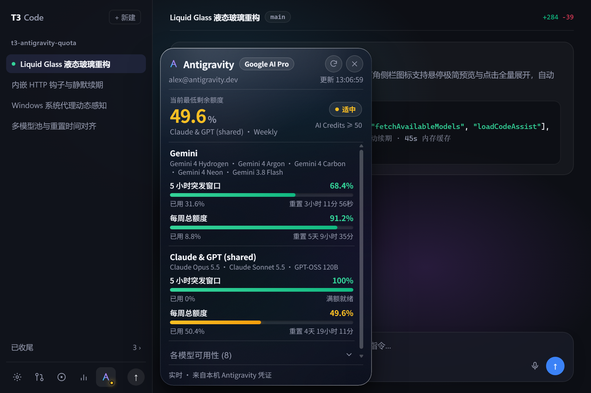
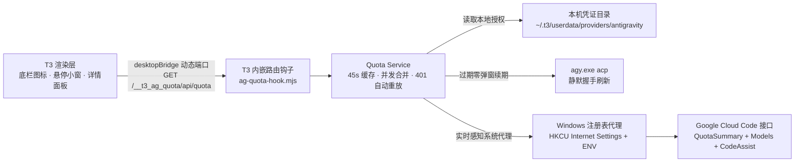

[](#) [](https://nodejs.org/) [](./package.json) [](#) [](./LICENSE)

> **把 Antigravity 额度感知做成 T3 Code 里原本就该长成的样子。**  
> 不占聊天区一寸空间，不遮挡发送按钮，不依赖脆弱的开机自启脚本——只需将鼠标轻触左下角任务栏的棱镜图标，即可透过光学液态玻璃一眼看清 `Gemini` 与 `Claude & GPT` 双池实时余量。

---

## 📸 实机视觉展示

### 01 · 悬停即现：左下任务栏原生融合 + 极简液态玻璃预览

插件自动嵌入 T3 Code 左侧底栏图标列（紧随 `⚙ · ⑂ · ⊙ · 📊` 右侧，尺寸与原生图标完全一致的 `32×32` 热区，右下角附带 `5px` 语义呼吸色点）。**鼠标悬停瞬间**，侧栏右侧即刻浮现静态光学折射小窗，无需点击即可速览全池余量与重置倒计时：


---

### 02 · 点击深潜：原位切换全量详情面板

**轻点同一枚图标**，迷你预览窗在原锚点无缝展开为完整详情面板：直观呈现当前账号订阅等级（如 `Google AI Pro`）、`AI Credits`、全局最低瓶颈窗口，以及按共享池拆分的 **5 小时突发窗口** 与 **每周总额度**（对尚未消耗的 `100%` 窗口自动剔除虚假倒计时，改标为「满额就绪」）：



---

### 03 · 亮暗同辉：晶体亮色适配 + 单模型可用性透视

实时跟随 T3 Code 的 `html.dark` 主题切换与系统配色方案。展开底部的 **「各模型可用性」** 抽屉，即可逐一检视 `Gemini 4 Hydrogen / Carbon / Neon`、`Claude Opus / Sonnet 5.5` 等全部模型的实时配额芯片：


---

### 04 · 分级预警：低额度脉冲与耗尽态提示

当任一配额池跌破阈值时，底栏角标与面板进度条同步切换语义色阶；低于 `10%` 触发柔和呼吸提示，归零时明确标示 **「已耗尽」** 与精确到秒的恢复倒计时：


---

## ✨ 为什么重构为 v2？

| 过去常见的痛点 | T3 Antigravity Quota v2 的解法 |
| :--- | :--- |
| 悬浮球体积硕大，死死挡住右下角发送键与语音键 | **原生嵌入侧栏底栏图标列**，启动页与设置页自动隐身，聊天输入区 100% 零遮挡 |
| 依赖 Windows 启动文件夹 `.lnk` 或独立后台进程，重启电脑即失联 | **直接内嵌至 T3 自身 HTTP 服务（`/__t3_ag_quota`）**，通过 `desktopBridge` 动态寻址，随开随用 |
| 开机后先开 T3 再开 Clash / v2rayN，或者代理端口变化就直接断网报错 | **动态解析环境变量与 Windows 注册表代理**，连接失败自动刷新缓存并支持直连回退 |
| OAuth Token 一满 1 小时过期就罢工，必须先去聊天框发消息续命 | **内置 `agy.exe acp` 无弹窗静默续期引擎**，后台自动换取新令牌并无感重试 |
| 毛玻璃发白起雾、双层边框错位、鼠标追光喧宾夺主 | **双层纯净光学液态玻璃**：`blur(36px) saturate(210%)` + `1px` 菲涅尔高光边缘，无多余鼠标滑光 |

---

## ⚡ 30 秒快速安装

> [!IMPORTANT]
> **环境前提**：Windows 10 / 11 系统，已安装 **Node.js ≥ 18**，且本机 **T3 Code (Beta)** 已登录 Antigravity 账号。

### 方式 A：双击一键脚本（最省心）

1. 克隆或下载并解压本仓库；
2. 双击运行根目录下的 **`install.cmd`** —— 脚本会自动安全关闭 T3 Code、完成备份与注入，并重新拉起 T3 Code。

### 方式 B：终端命令安装

```powershell
git clone https://github.com/woodenpiger/t3-antigravity-quota.git
cd t3-antigravity-quota

# 自动关闭 T3 Code、备份原版 server.asar 并注入插件
node scripts/install.mjs --close-t3
```

如果你的 T3 Code 安装在自定义路径，可通过 `--install-dir` 指定目录：

```powershell
node scripts/install.mjs --close-t3 --install-dir "D:\Apps\t3code"
```

### 状态诊断与一键无损卸载

```powershell
# 探活检查：验证内嵌路由与额度响应状态
node scripts/health.mjs

# 无损卸载：校验备份 SHA-256 并字节级还原原版 server.asar（也可直接双击 uninstall.cmd）
node scripts/uninstall.mjs --close-t3
```

---

## 🧠 架构与数据流

插件由 **渲染层双态视图** 与 **服务端内嵌配额聚合引擎** 两部分组成，全程 **0 个第三方 npm 依赖**：



### 额度色阶语义标准

| 剩余比例 | 状态词 | 颜色语义 | 界面表现 |
| :---: | :---: | :---: | :--- |
| `100%`（未触碰） | **满额就绪** | 翠绿 `#34D399` | 屏蔽上游合成的 5h 假倒计时，直接标注满额待命 |
| `60% ~ 100%` | **充沛** | 翠绿 `#34D399` | 绿色渐变液态填充条 + 绿色状态角标 |
| `30% ~ 59.9%` | **适中** | 琥珀 `#FBBF24` | 琥珀色渐变填充条 + 剩余重置时间 |
| `10% ~ 29.9%` | **偏低** | 暖橙 `#FB923C` | 橙色预警填充条，提醒留意消耗节奏 |
| `0.1% ~ 9.9%` | **危急** | 珊瑚红 `#F87171` | 红色填充条配合温和呼吸动效（遵循系统减弱动画设置） |
| `0%` | **已耗尽** | 警示红 `#EF4444` | 标注「已耗尽」并突出显示窗口恢复倒计时 |

---

## 🛡️ Google 合规防封保护、隐私与可逆承诺

> [!TIP]
> 本插件严格对齐 T3 Code 官方内置 `antigravityUsageLimits` 探针协议，**零遥测、零静默轮询轰炸、零非常规接口伪造，多重防频控熔断机制保障账号绝对安全**。

- **严格遵循官方请求规范（防封号保护）**：
  - **零后台静默轮询**：面板收起时不进行任何后台定时轮询；仅在用户主动悬停/展开且缓存满 `60s` 时按需单次同步。
  - **请求体积缩减 >66%**：日常查询仅发起单次轻量 `retrieveUserQuotaSummary`；套餐信息（`loadCodeAssist`）缓存 `30` 分钟、模型目录（`fetchAvailableModels`）缓存 `5` 分钟，手动刷新按钮内置 `15s` 防连点节流。
  - **429 / 403 熔断退避与 ACP 冷却锁**：若遇上游 `429` / `403` 立即触发 `5` 分钟熔断冷却（绝不死循环重试）；静默凭证续期内置 `10` 分钟冷却锁与进程句柄强回收，杜绝并发抢占。
  - **全链路硬超时防空转**：前端 `fetch`（`11s`）、服务端聚合（`12.5s`）与代理隧道底层均设硬性挂钟超时，断网或额度归零时绝不无限转圈卡死。
- **严格通信边界**：仅访问本机回环 `127.0.0.1` 与 Google 官方鉴权/配额端点（`daily-cloudcode-pa.googleapis.com`、`cloudcode-pa.googleapis.com`、`oauth2.googleapis.com`）。
- **敏感凭据脱敏**：`access_token`、`refresh_token`、`client_secret` 仅驻留服务端内存用于请求签名，所有返回报文与异常提示均经 `sanitizeError()` 过滤，绝不写入前端或日志。
- **回环 CORS 锁死**：内嵌接口仅允许 `t3code://app` 与本机回环来源调用，拒绝外部网页跨站探测。
- **字节级无损还原**：首次安装自动生成带版本号与 SHA-256 指纹的 `server.asar.bak-*` 原始备份，保留全部 `24` 个 `unpacked` 原生二进制模块，绝不修改 `app.asar`。

---

## 🛠️ 目录结构与本地开发

```text
t3-antigravity-quota/
├── install.cmd / uninstall.cmd   # Windows 双击一键安装与还原脚本
├── package.json                  # 零依赖脚本入口定义
├── renderer/
│   ├── antigravity-quota.js      # 底栏停靠探测、悬停预览、点击详情与自动恢复
│   └── antigravity-quota.css     # 液态玻璃折射、菲涅尔高光边框与双主题样式
├── helper/
│   ├── quota-service.cjs         # 多账号扫描、ACP 续期、三接口并行聚合与缓存
│   ├── fixture-server.cjs        # 本地多场景 Mock 服务（showcase / healthy / exhausted）
│   ├── lib/                      # 核心标准化、路由分发、注册表代理与 HTTPS 客户端
│   └── test/quota.test.cjs       # 17 项 Node 原生单元测试
├── scripts/
│   ├── ag-quota-hook.mjs         # 挂载至 T3 server.asar 的内嵌 HTTP 路由钩子
│   ├── asar-lib.mjs / patch.mjs  # 纯自研 ASAR 解析与 SHA-256 完整性重打包器
│   ├── install.mjs / uninstall.mjs # 幂等安装器与验签还原卸载器
│   └── preview-server.mjs        # 本地前端热预览服务器
├── fixtures/preview.html         # 1:1 仿真 T3 工作台预览沙箱
└── docs/                         # 矢量头图与 2x Retina 实机展示图
```

本地运行测试与独立预览沙箱（无需改动真实 T3 客户端）：

```powershell
# 运行全部 17 项单元测试
npm test

# 终端 1：启动展示级 Mock 数据源
node helper/fixture-server.cjs showcase 47899

# 终端 2：启动 UI 预览服务
node scripts/preview-server.mjs 47899 47898
```

随后在浏览器访问：
- **暗色悬停简易窗**：`http://127.0.0.1:47898/?port=47899&mini=1`
- **暗色完整详情窗**：`http://127.0.0.1:47898/?port=47899&open=1`
- **亮色展开模型态**：`http://127.0.0.1:47898/?port=47899&theme=light&open=1&models=1`

---

## 📄 开源许可

基于 [MIT License](./LICENSE) 开源发布。  
*本项目为独立社区增强工具，与 T3 Code 及 Google 官方无隶属或背书关系。*
