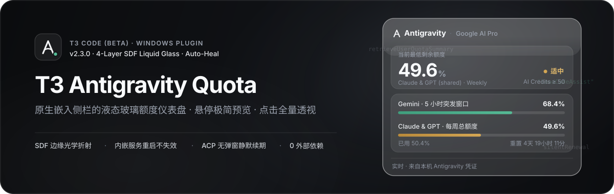
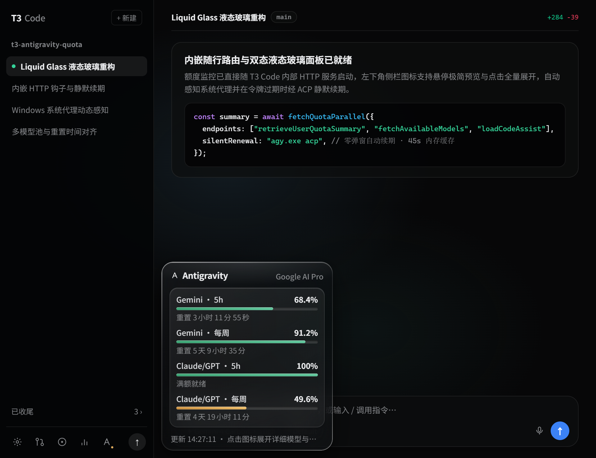
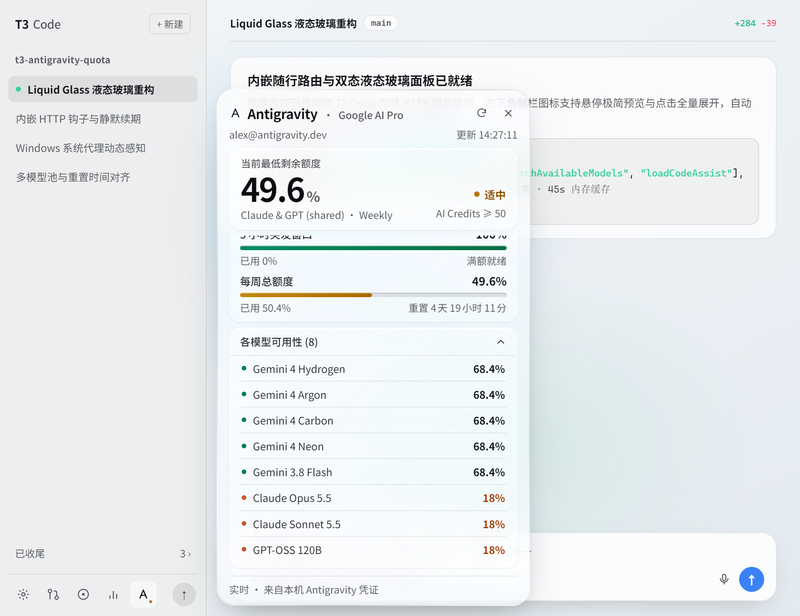
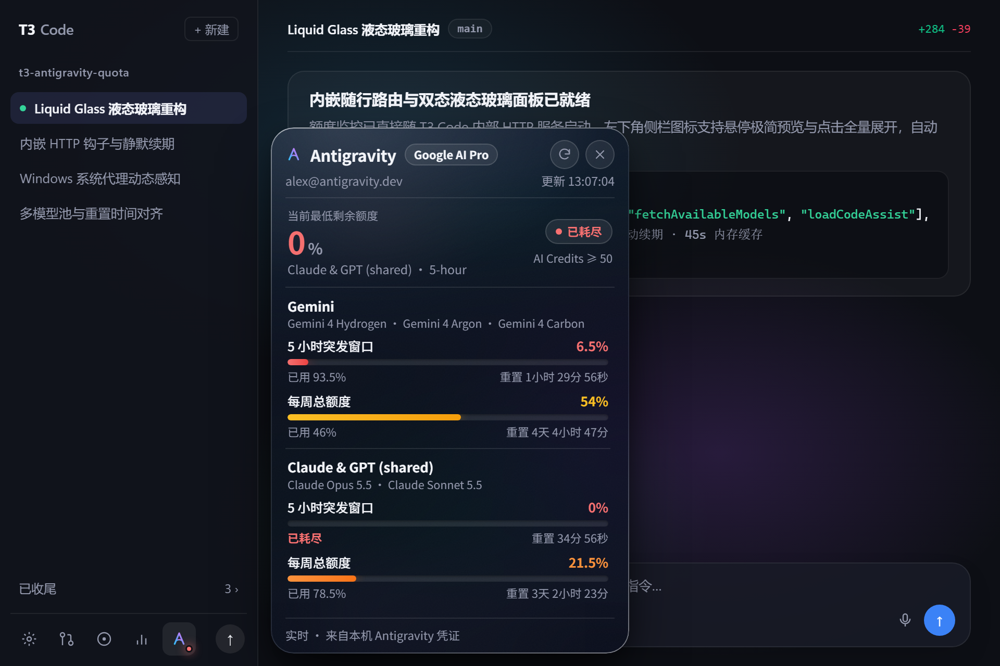
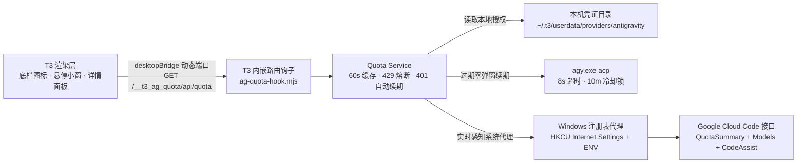

[](#) [](https://nodejs.org/) [](./package.json) [](https://github.com/woodenpiger/t3-antigravity-quota/releases) [](./LICENSE)

> **把 Antigravity 额度感知做成 T3 Code 里原本就该长成的样子。**  
> 不占聊天区一寸空间，不遮挡发送按钮，不依赖脆弱的开机自启脚本——只需将鼠标轻触左下角侧栏的极简棱镜图标，即可透过 **4 层 SDF 光学液态玻璃** 一眼看清 `Gemini` 与 `Claude & GPT` 双池实时余量。

---

## 📸 实机视觉展示（v2.2.0）

### 01 · 悬停即现：左下任务栏原生融合 + 极简液态玻璃预览

插件自动嵌入 T3 Code 左侧底栏图标列（紧随 `⚙ · ⑂ · ⊙ · 📊` 右侧，尺寸与原生图标完全一致的 `32×32` 热区，右下角附带 `6.5px` 矿石色语义点）。**鼠标悬停瞬间**，侧栏右侧即刻浮现 SDF 液态玻璃极简预览窗，与详情面板共享同一份规范化数据与时间戳，无需点击即可速览全池余量与重置倒计时：



---

### 02 · 点击深潜：原位展开 4 层液态玻璃详情面板

**轻点同一枚图标**，在原锚点以原生 `<dialog popover="auto">` 顶层弹层无缝展开完整详情面板：外框搭载边缘 SDF `<feDisplacementMap>` 透镜折射与 `1.25px` 镜面渐变描边，内部以半透明玻璃子卡清晰分层呈现 `Google AI Pro` 订阅、`AI Credits`、全局瓶颈指标，以及 `Gemini` 与 `Claude & GPT` 双池的 **5 小时突发窗口 / 每周总额度**（对尚未消耗的 `100%` 窗口自动过滤上游虚假倒计时，直标「满额就绪」）：


---

### 03 · 亮暗同辉：晶透石英亮色适配 + 单模型可用性表格索引

实时跟随 T3 Code 的 `html.dark` 主题切换与系统配色方案。展开底部的 **「各模型可用性」** 内玻璃抽屉，以零截断的对齐列表行逐一检视 `Gemini 4 Hydrogen / Argon / Carbon / Neon`、`Gemini 3.8 Flash`、`Claude Opus / Sonnet 5.5` 与 `GPT-OSS 120B` 全部模型余量：



---

### 04 · 克制预警：仅在低额度与耗尽态精准高亮

告别满屏花哨的交通灯配色与廉价霓虹发光：健康与适中数值保持中性高对比墨色，仅在跌破 `30%`（陶土橙）或 `10%` / `0%`（朱红）时精准标色提示，并在 Protobuf3 省略 `remainingFraction` 字段时准确识别 **`0% 已耗尽`** 与恢复倒计时：



---

## ✨ v2.2.0 架构与视觉亮点

| 过去常见的痛点 | T3 Antigravity Quota v2.2.0 的解法 |
| :--- | :--- |
| 悬浮球遮挡右下角发送键，启动页/设置页也到处漂浮 | **原生嵌入侧栏底栏图标列**，启动页与设置页自动隐身，聊天输入区 100% 零遮挡 |
| 依赖开机自启脚本或独立后台进程，重启电脑即失联 | **直接内嵌至 T3 自身 HTTP 服务（`/__t3_ag_quota`）**，通过 `desktopBridge` 动态寻址，随开随用 |
| 先开 T3 再开 Clash / v2rayN，或代理端口变化即断网 | **动态解析环境变量与 Windows 注册表代理**，连接失败自动刷新代理缓存并支持直连回退 |
| OAuth Token 1 小时过期即报错，或额度归零时无限转圈 | **内置 `agy.exe acp` 无弹窗静默续期** + 四层挂钟硬超时（`11s` / `12.5s` / `8s` 进程强回收） |
| 廉价霓虹发光、紫蓝 AI 雾感、毛玻璃糊成死灰实底框 | **4 层真·液态玻璃 + Suzhe 字体体系**：低 Alpha 透射（`0.44–0.64`）、边缘 SDF `feDisplacementMap` 折射、`1.25px` 镜面描边、内玻璃子卡分层与 `blur(18px)` 低开销渲染预算 |

完整版本变更记录请参阅 [CHANGELOG.md](./CHANGELOG.md)。

---

## ⚡ 30 秒快速安装

> [!IMPORTANT]
> **环境前提**：Windows 10 / 11 系统，已安装 **Node.js ≥ 18**，且本机 **T3 Code (Beta)** 已登录 Antigravity 账号。

### 方式 A：下载 Release 压缩包双击安装（最省心）

1. 前往 [Releases](https://github.com/woodenpiger/t3-antigravity-quota/releases) 下载最新版 **`t3-antigravity-quota-v2.2.0.zip`** 并解压；
2. 双击运行根目录下的 **`install.cmd`** —— 脚本会自动安全关闭 T3 Code、生成原版 SHA-256 备份、完成注入，并重新启动 T3 Code。

### 方式 B：命令行克隆安装

```powershell
git clone https://github.com/woodenpiger/t3-antigravity-quota.git
cd t3-antigravity-quota

# 自动关闭 T3 Code、备份原版 server.asar 并注入插件
node scripts/install.mjs --close-t3
```

如果你的 T3 Code 安装在自定义路径，可通过 `--install-dir` 指定目录：

```powershell
node scripts/install.mjs --close-t3 --install-dir "D:\Apps\t3code"
```

### 状态诊断与一键无损卸载

```powershell
# 探活检查：验证内嵌路由与额度响应状态
node scripts/health.mjs

# 无损卸载：校验备份 SHA-256 并字节级还原原版 server.asar（也可直接双击 uninstall.cmd）
node scripts/uninstall.mjs --close-t3
```

---

## 🧠 架构与数据流

插件由 **渲染层双态液态玻璃视图** 与 **服务端内嵌配额聚合引擎** 两部分组成，全程 **0 个第三方 npm 依赖**：



### 额度色阶语义标准（OKLCH 矿石色系）

| 剩余比例 | 状态词 | 视觉语义 | 界面表现 |
| :---: | :---: | :--- | :--- |
| `100%`（未触碰） | **满额就绪** | 矿石翡翠绿 + 中性墨色数字 | 屏蔽上游合成的 5h 假倒计时，直接标注「满额就绪」 |
| `60% ~ 100%` | **充沛** | 矿石翡翠绿凹槽填充 | 进度条使用细腻顶部反光填充，数值保持清晰中性墨色 |
| `30% ~ 59.9%` | **适中** | 暖赭琥珀凹槽填充 | 温和提示消耗进度与重置倒计时，避免视觉噪音 |
| `10% ~ 29.9%` | **偏低** | 陶土橙进度条 + 橙色数值 | 明确提醒留意模型配额消耗节奏 |
| `0.1% ~ 9.9%` | **危急** | 朱红进度条 + 朱红数值 | 全局最低指标与对应窗口同步标红预警 |
| `0%` | **已耗尽** | 朱红状态点 + 「已耗尽」 | 准确解析 Protobuf3 省略的 `0%` 字段并显示精确恢复倒计时 |

---

## 🛡️ Google 合规防封保护、隐私与无障碍

> [!TIP]
> 本插件严格对齐 T3 Code 官方内置 `antigravityUsageLimits` 探针协议：**零遥测、零静默后台轮询、零非常规接口伪造，多重防频控熔断与无障碍降级保障安全可靠**。

- **严格遵循官方请求规范（防封号保护）**：
  - **零后台静默轮询**：面板收起时不进行任何后台定时轮询；仅在用户主动悬停/展开且缓存满 `60s` 时按需单次同步。
  - **请求体积缩减 >66%**：日常查询仅发起单次轻量 `retrieveUserQuotaSummary`；套餐信息（`loadCodeAssist`）缓存 `30` 分钟、模型目录（`fetchAvailableModels`）缓存 `5` 分钟，手动刷新内置 `15s` 防连点节流。
  - **429 / 403 熔断退避与 ACP 冷却锁**：若遇上游 `429` / `403` 立即触发 `5` 分钟熔断冷却（绝不死循环重试）；静默凭证续期内置 `10` 分钟冷却锁与进程管道强销毁，杜绝并发抢占。
  - **四层硬超时防无限转圈**：前端 `fetch`（`11s`）、服务端聚合（`12.5s`）、ACP 子进程（`8s`）与代理隧道底层均设挂钟硬超时，断网或额度归零时绝不卡死。
- **严格通信与凭据边界**：仅访问本机回环 `127.0.0.1` 与 Google 官方端点（`daily-cloudcode-pa.googleapis.com`、`cloudcode-pa.googleapis.com`、`oauth2.googleapis.com`）；所有 Token 仅驻留内存，错误报文经 `sanitizeError()` 脱敏；内嵌路由锁定回环与 `t3code://app` 来源。
- **无障碍与渲染预算**：支持 `prefers-reduced-transparency: reduce`（自动退回不透明高对比表面）、`prefers-reduced-motion: reduce` 与 Windows 高对比度模式（`forced-colors: active`）；`backdrop-filter` 严格控制在 `≤ 18px` 且零 `requestAnimationFrame` 空转循环。
- **字节级无损还原**：首次安装自动生成带版本号与 SHA-256 指纹的 `server.asar.bak-*` 原始备份，保留全部 `24` 个 `unpacked` 原生二进制模块，绝不修改 `app.asar`。

---

## 🛠️ 目录结构与本地开发

```text
t3-antigravity-quota/
├── install.cmd / uninstall.cmd   # Windows 双击一键安装与还原脚本
├── package.json                  # 零依赖脚本入口定义
├── CHANGELOG.md                  # 版本更新日志
├── renderer/
│   ├── antigravity-quota.js      # 底栏停靠、SDF 液态透镜生成、悬停/详情双态同步
│   └── antigravity-quota.css     # 4 层液态玻璃光学、Suzhe 排版与双主题样式
├── helper/
│   ├── quota-service.cjs         # 多账号扫描、ACP 续期、分层缓存与 429 熔断
│   ├── fixture-server.cjs        # 本地多场景 Mock 服务（showcase / healthy / exhausted）
│   ├── lib/                      # 核心标准化、路由分发、注册表代理与 HTTPS 客户端
│   └── test/quota.test.cjs       # 19 项 Node 原生单元测试
├── scripts/
│   ├── ag-quota-hook.mjs         # 挂载至 T3 server.asar 的内嵌 HTTP 路由钩子
│   ├── asar-lib.mjs / patch.mjs  # 纯自研 ASAR 解析与 SHA-256 完整性重打包器
│   ├── install.mjs / uninstall.mjs # 幂等安装器与验签还原卸载器
│   └── preview-server.mjs        # 本地前端热预览服务器
├── fixtures/preview.html         # 1:1 仿真 T3 工作台预览沙箱
└── docs/                         # 矢量头图、2x Retina 实机截图与发布说明
```

本地运行全部测试与独立预览沙箱（无需改动真实 T3 客户端）：

```powershell
# 运行全部 19 项单元测试
npm test

# 终端 1：启动展示级 Mock 数据源
node helper/fixture-server.cjs showcase 47899

# 终端 2：启动 UI 预览服务
node scripts/preview-server.mjs 47899 47898
```

随后在浏览器访问：
- **暗色悬停简易窗**：`http://127.0.0.1:47898/?port=47899&mini=1`
- **暗色完整详情窗**：`http://127.0.0.1:47898/?port=47899&open=1`
- **亮色展开模型态**：`http://127.0.0.1:47898/?port=47899&theme=light&open=1&models=1`

---

## 📄 开源许可

基于 [MIT License](./LICENSE) 开源发布。  
*本项目为独立社区增强工具，与 T3 Code 及 Google 官方无隶属或背书关系。*
